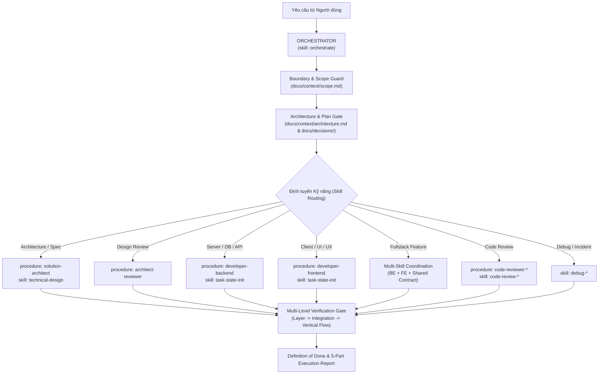

# AGENTS.md — Điều phối Kỹ năng & Phân công Agent (Orchestration Hub)

> Tài liệu quy định nguyên tắc điều phối (Routing), kích hoạt kỹ năng và thực thi quy trình cho các Agent trên Antigravity.
> **Orchestrator** tự động phân loại tác vụ, nạp ngữ cảnh theo thứ bậc từ `docs/`, kiểm soát các cổng (Gates) và kích hoạt kỹ năng chuyên môn inline mà **không yêu cầu người dùng chuyển agent thủ công**.

---

## 1. Mô hình Điều phối Trung tâm (Orchestration Routing Model)

---

## 2. Bảng Ma trận Định tuyến Kỹ năng (Skill Routing Matrix)

| Lĩnh vực / Tác vụ | Agent Procedure | Kỹ năng Kích hoạt | Tài liệu Tham chiếu |
|---|---|---|---|
| **Điều phối chung & Gates** | `orchestrator` | `orchestrate` | `AGENTS.md`, `docs/context/workflow.md`, `docs/context/scope.md` |
| **Đặc tả & Thiết kế Kỹ thuật** | `solution-architect` | `technical-design` | `docs/specs/business-spec/`, `docs/context/architecture.md`, `docs/specs/design/` |
| **Rà soát Hồ sơ Thiết kế** | `architect-reviewer` | `decisions-relevance` | `docs/specs/design/`, `docs/guidelines/`, `docs/context/scope.md` |
| **Phát triển Phía Server (BE)** | `developer-backend` | `task-state-init`, `progress-tracker` | `docs/guidelines/backend/`, `docs/context/architecture.md` |
| **Phát triển Phía Client (FE)** | `developer-frontend` | `task-state-init`, `progress-tracker` | `docs/guidelines/frontend/`, `docs/context/architecture.md` |
| **Review Code Đa chiều (4D)** | `code-reviewer-*` | `code-review-backend`, `code-review-frontend` | `docs/guidelines/*/coding-convention.md`, `security-policy.md` |
| **Xác minh Hoàn tất (Vertical Flow)** | `orchestrator` / `developer-*` | `verification` | `docs/specs/verification/`, `docs/specs/tasks/` |
| **Chẩn đoán Lỗi & Sửa Bug** | `developer-*` | `debug-backend`, `debug-frontend` | `docs/guidelines/shared/gotchas.md` |

---

## 3. Điều phối Tính năng Đa miền (Multi-Skill Coordination)

Khi một tính năng chạm tới cả Backend, Frontend và Database (Fullstack):
1. **Thiết lập Hợp đồng Chung (Shared Contract):** Thống nhất API DTO, Schema dữ liệu và mã lỗi trước khi viết code.
2. **Triển khai Độc lập theo Tầng:** Kích hoạt `developer-backend` và `developer-frontend` theo đúng convention của từng tầng.
3. **Xác minh Liên tầng (Integration & Vertical):** Kích hoạt `verification` để kiểm chứng luồng hoạt động thực tế từ UI $\rightarrow$ API $\rightarrow$ Database $\rightarrow$ State.

---

## 4. Ràng buộc Điều phối (Coordinator Constraints)

- **Tự động Thực thi Inline:** AI Coordinator tự điều phối và thực thi procedure inline, không yêu cầu người dùng chuyển đổi agent thủ công.
- **Bảo vệ Ranh giới (Scope Guard):** Nếu yêu cầu vượt phạm vi hiện tại (Out of Scope), bắt buộc DỪNG LẠI, ghi nhận đề xuất vào backlog và xin xác nhận.
- **Kiểm soát Kiến trúc (Architecture Guard):** Mọi thay đổi về Data Model, API Breaking Change, hoặc thêm Library phải qua bước lập ADR và xin phê duyệt.
