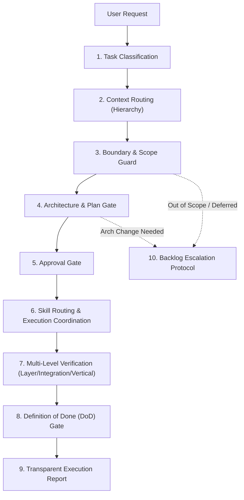

# Orchestrator — Central Engineering Workflow Controller

> Kỹ năng điều phối trung tâm (Orchestration Skill) chịu trách nhiệm dẫn dắt toàn bộ chu trình xử lý yêu cầu kỹ thuật trên Antigravity.
> **Nguyên tắc bất biến:** Orchestrator là **Workflow Controller**, KHÔNG PHẢI Domain Expert. Orchestrator điều phối các chuyên gia/kỹ năng chuyên biệt và áp đặt các cổng kiểm soát (Gates), không can thiệp viết code hay chứa quy chuẩn kỹ thuật cụ thể của framework.

---

## 1. Bản đồ Quy trình Điều phối (Orchestration Pipeline)



---

## 2. Chi tiết 9 Bước Điều phối

### Bước 1: Phân loại Tác vụ (Task Classification)
Trước khi thực hiện bất kỳ hành động nào, Orchestrator phân loại request vào đúng 1 nhóm:

| Loại Tác vụ | Mô tả | Chiều sâu Quy trình |
|---|---|---|
| `QUESTION` | Câu hỏi giải thích, tra cứu, phân tích (không sinh code). | Tra cứu context $\rightarrow$ Trả lời trực tiếp. |
| `TRIVIAL` | Sửa lỗi typo, đổi text, sửa 1 dòng cấu hình hiển thị rõ ràng. | Hiểu $\rightarrow$ Sửa $\rightarrow$ Verify nhanh. |
| `BUG_FIX` | Sửa lỗi hệ thống, giao diện hoặc logic nghiệp vụ. | Tái hiện $\rightarrow$ Chẩn đoán $\rightarrow$ Sửa $\rightarrow$ Verify layer. |
| `SMALL_MODIFY` | Mở rộng hoặc tinh chỉnh nhẹ logic/hành vi có sẵn. | Context liên quan $\rightarrow$ Kế hoạch ngắn $\rightarrow$ Làm $\rightarrow$ Verify. |
| `NEW_FEATURE` | Phát triển tính năng mới nằm trong phạm vi (In-Scope MVP). | Requirements $\rightarrow$ Design $\rightarrow$ Plan 9 mục $\rightarrow$ Code $\rightarrow$ Vertical Verify $\rightarrow$ DoD. |
| `ARCHITECTURAL_CHANGE` | Thay đổi data model, contract API, auth, migration, add package. | Scope check $\rightarrow$ Phân tích kiến trúc $\rightarrow$ Lập ADR $\rightarrow$ Phê duyệt $\rightarrow$ Code $\rightarrow$ E2E Verify. |

---

### Bước 2: Nạp Ngữ cảnh theo Thứ bậc (Context Routing)
Áp dụng cơ chế **Lazy Loading** theo thứ tự phụ thuộc chuẩn:
```text
Layer 0 — Agent Contract (AGENTS.md / MUST & NEVER)
Layer 1 — Project Context (docs/context/project-context.md)
Layer 2 — Scope / Constraints (docs/context/scope.md)
Layer 3 — Architecture (docs/context/architecture.md)
Layer 4 — Requirements / SRS (docs/specs/business-spec/ hoặc docs/srs/)
Layer 5 — Technical Design (docs/specs/design/)
Layer 6 — Existing Implementation (Source code liên quan)
Layer 7 — Execution State (.agents/state/<dev-id>/current-task.md)
```
- **Chỉ nạp những gì cần thiết** cho loại task hiện tại, chống làm loãng ngữ cảnh (Context Pollution).

---

### Bước 3: Cổng Kiểm soát Ranh giới (Boundary & Scope Guard)
Orchestrator đối chiếu yêu cầu với `docs/context/scope.md`:
- **In Scope:** Cho phép tiếp tục sang Bước 4.
- **Out of Scope hoặc Deferred:** 
  - **DỪNG LẠI NGAY LẬP TỨC (STOP)**.
  - Giải thích vi phạm ranh giới cho người dùng.
  - Kích hoạt *Backlog Escalation Protocol* (ghi nhận đề xuất backlog).
  - Yêu cầu quyết định từ con người; không tự tiện làm vì "sẵn tiện sửa code".

---

### Bước 4: Cổng Kế hoạch & Rà soát Kiến trúc (Architecture & Plan Gate)
1. **Kiểm tra tác động kiến trúc (Architecture Impact Check):**
   - Nếu có tác động kiến trúc $\rightarrow$ Yêu cầu tài liệu ADR (`docs/decisions/`) và dừng chờ phê duyệt.
2. **Lập Kế hoạch Thích ứng (Adaptive Planning):**
   - **Trivial / Small:** Kế hoạch ngắn gọn (Mục tiêu $\rightarrow$ Vùng tác động $\rightarrow$ Cách làm $\rightarrow$ Cách kiểm thử).
   - **Feature (Plan 9 mục chuẩn):**
     1. Goal & Scope
     2. Data Flow
     3. Affected Modules
     4. API / Interface Changes
     5. UI / UX Impact (nếu có)
     6. Edge Cases
     7. Risks & Assumptions
     8. Testing Strategy
     9. Architecture Impact

---

### Bước 5: Cổng Phê duyệt (Approval Gate)
Áp dụng chính sách phê duyệt:
- `TRIVIAL / QUESTION`: Không cần approval.
- `SMALL_MODIFY / BUG_FIX`: Implicit approval (trừ khi có rủi ro cao).
- `NEW_FEATURE`: Plan review required (thông báo plan trước khi thực thi).
- `ARCHITECTURAL_CHANGE`: Explicit human approval bắt buộc trước khi chạm vào code.

---

### Bước 6: Định tuyến & Điều phối Kỹ năng Chuyên môn (Skill Routing & Subagent Harness)
Orchestrator xác định và kích hoạt các chuyên gia kỹ thuật phù hợp, đồng thời áp đặt **Document Harness** chặt chẽ:
- **Backend Concern:** Kích hoạt chuyên gia Backend (`developer-backend`, `docs/guidelines/backend/`).
- **Frontend Concern:** Kích hoạt chuyên gia Frontend (`developer-frontend`, `docs/guidelines/frontend/`).
- **Multi-domain / Fullstack:** Điều phối hợp đồng giao tiếp chung (Shared Contract / DTO) trước khi các skill con thực thi độc lập.
- **Review Concern:** Kích hoạt `code-reviewer-backend` hoặc `code-reviewer-frontend`.

#### Ràng buộc Subagent Document Harness (Chống Lạm phát Tài liệu):
1. **Headless Execution (Thực thi Không Rườm rà):** Subagent chạy inline hoặc background để thực hiện tác vụ kỹ thuật cụ thể (viết code, chạy test, audit). CẤM subagent tạo các file markdown trung gian (`BRIEFING.md`, `DISPATCH.md`, `handoff.md`, `progress.md`) trên đĩa.
2. **Kênh Phản hồi:** Mọi kết luận, review verdict (`APPROVE` / `REQUEST_CHANGES`), log kiểm thử đều phải gửi qua tin nhắn hội thoại hoặc console stdout, không ghi ra file markdown rời rạc.
3. **Ngân sách Tài liệu (Document Budget):**
   - `QUESTION` / `TRIVIAL`: 0 file markdown.
   - `BUG_FIX` / `SMALL_MODIFY`: 0 file markdown mới (chỉ sửa code + báo cáo 5 điểm inline).
   - `NEW_FEATURE`: Tối đa 1 file spec/plan hợp nhất nếu cần; tuyệt đối không sinh 3 file design trống hoặc chia nhỏ thành nhiều plan lắt nhắt.
   - `ARCHITECTURAL_CHANGE`: Duy nhất 1 file ADR trong `docs/decisions/`.
4. **Đơn nguồn Chân lý State:** Toàn bộ trạng thái phiên làm việc chỉ được lưu tại `.agents/state/<dev-id>/current-task.md`. Subagent không được tạo thư mục state riêng.

---

### Bước 7: Điều phối Xác minh Đa cấp (Verification Orchestration)
Tùy theo loại task, Orchestrator yêu cầu các mức xác minh tương ứng:
1. **Layer Verification:** Unit test, linter, compile pass cho từng module riêng lẻ.
2. **Integration Verification:** Kiểm thử tương tác giữa các tầng (API Call, DB Query, State Store).
3. **Vertical Verification (Xác minh luồng thực tế):** Bắt buộc cho mọi tính năng có trải nghiệm người dùng (User-facing feature). Phải kiểm chứng toàn bộ luồng từ UI $\rightarrow$ API $\rightarrow$ Backend $\rightarrow$ DB $\rightarrow$ State $\rightarrow$ Re-open/Refresh.

---

### Bước 8: Đánh giá Tiêu chuẩn Hoàn thành (Definition of Done — DoD)
Chỉ chuyển trạng thái sang **DONE** khi đáp ứng đủ:
- [x] Đúng phạm vi được duyệt (In-scope satisfied).
- [x] Đầy đủ yêu cầu nghiệp vụ (Requirements met).
- [x] Không còn lỗi compile/linter/blocking bug.
- [x] Đã vượt qua các cấp độ verification tương ứng.
- [x] Ràng buộc kiến trúc không bị vi phạm.
- [x] Nợ kỹ thuật (nếu có) được công khai minh bạch.

---

### Bước 9: Báo cáo Thực thi Minh bạch 5 Điểm (Execution Report)
Mọi phản hồi hoàn thành task kỹ thuật phải tuân thủ hợp đồng 5 điểm:
1. **What changed:** Danh sách file và tính năng đã thêm/sửa/xóa.
2. **Why:** Lý do kỹ thuật hoặc mục tiêu nghiệp vụ.
3. **Risk / Impact level:** Mức độ rủi ro hệ thống (Low / Medium / High).
4. **Assumptions:** Các giả định kỹ thuật đã đưa ra.
5. **Not done / Remaining:** Các phần việc tồn đọng hoặc bước tiếp theo.

---

### Bước 10: Giao thức Đưa vào Backlog (Backlog Escalation Protocol)
Tự động ghi nhận hoặc đề xuất ghi nhận backlog khi:
- Người dùng chủ động hoãn yêu cầu (*"để sau", "phase 2"*).
- Phát hiện yêu cầu ngoài scope hoặc nợ kỹ thuật tiềm ẩn.
- Phát hiện edge-case phức tạp chưa an toàn để xử lý ngay.

---

## 3. Ràng buộc Tối cao của Orchestrator (MUST & NEVER)

### MUST
- **MUST** phân loại task trước khi hành động.
- **MUST** áp dụng quy trình tối thiểu đủ dùng (*Minimum sufficient process*), không ép quy trình nặng nề cho task nhỏ.
- **MUST** thực thi Document Harness: Kiểm soát nghiêm ngặt ngân sách tài liệu sinh ra và buộc subagent hoạt động theo chế độ lean/headless.
- **MUST** dừng lại và báo cáo khi phát hiện vi phạm ranh giới (Scope violation) hoặc tác động kiến trúc chưa phê duyệt.
- **MUST** yêu cầu Vertical Verification cho các tính năng người dùng trước khi đánh dấu hoàn thành.

### NEVER
- **NEVER** tự ý viết code nghiệp vụ bên trong Orchestrator (hãy để domain skills thực hiện).
- **NEVER** âm thầm mở rộng scope hoặc tự tiện thêm library/framework ngoài danh mục duyệt.
- **NEVER** coi một tính năng hoàn thành chỉ vì build/compile pass.
- **NEVER** nạp toàn bộ tài liệu dự án một cách bừa bãi khi xử lý task nhỏ.
- **NEVER** để subagents tạo file markdown tạm thời, ceremony documents (`BRIEFING.md`, `DISPATCH.md`, `handoff.md`, `progress.md`), hoặc sinh các thư mục state rác ngoài `.agents/state/<dev-id>/current-task.md`.
