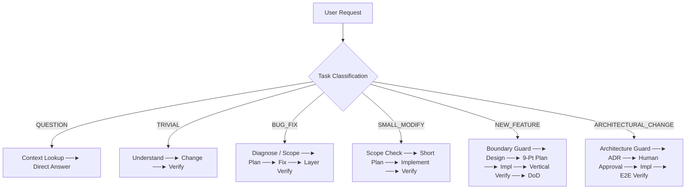

# AI Operating Protocol (Workflow Model) — Music Tracker

> Quy chuẩn vận hành kỹ thuật tổng quát cho AI Agent trong dự án Music Tracker trên Antigravity.
> Tích hợp tri thức thực chiến: Phân loại tác vụ, Điều phối kỹ năng, Kiểm soát ranh giới, Kế hoạch thích ứng, Xác minh theo chiều dọc và Báo cáo minh bạch.

---

## 1. 5 Tầng Trách nhiệm (Responsibility Layers)

Hệ thống phân tách triệt để 5 tầng độc lập:

```text
┌─────────────────────────────────────────────────────────────┐
│ 1. AGENT CONTRACT      (AGENTS.md / MUST & NEVER)          │
│    -> Các quy tắc bất biến về hành vi bắt buộc / bị cấm    │
├─────────────────────────────────────────────────────────────┤
│ 2. ORCHESTRATOR        (.agents/skills/orchestrate/)        │
│    -> Điều phối phân loại, routing, boundary gate & DoD     │
├─────────────────────────────────────────────────────────────┤
│ 3. PROJECT KNOWLEDGE   (docs/)                              │
│    -> Ngữ cảnh nghiệp vụ, scope, kiến trúc, spec dự án      │
├─────────────────────────────────────────────────────────────┤
│ 4. SPECIALIZED SKILLS  (.agents/skills/ & docs/guidelines/) │
│    -> Kỹ năng chuyên môn sâu (Backend, Frontend, Review...) │
├─────────────────────────────────────────────────────────────┤
│ 5. EXECUTION STATE     (.agents/state/<dev-id>/)            │
│    -> Trạng thái thực thi hiện thời của task / session      │
└─────────────────────────────────────────────────────────────┘
```

---

## 2. Thứ tự Nạp Ngữ cảnh Chuẩn (Context Loading Hierarchy)

Khi xử lý một tác vụ, Agent nạp ngữ cảnh theo thứ bậc phụ thuộc từ trên xuống dưới (chỉ nạp những tài liệu cần thiết cho tác vụ đó — *Lazy Loading*):

```text
Layer 0 — Agent Contract (AGENTS.md, MUST/NEVER)
Layer 1 — Project Context (docs/context/project-context.md)
Layer 2 — Scope / Constraints (docs/context/scope.md)
Layer 3 — Architecture (docs/context/architecture.md)
Layer 4 — Requirements / SRS (docs/specs/business-spec/ hoặc docs/srs/)
Layer 5 — Technical Design (docs/specs/design/)
Layer 6 — Existing Implementation (Mã nguồn hiện tại)
Layer 7 — Execution State (.agents/state/<dev-id>/current-task.md)
```

---

## 3. Quy trình Vận hành Thích ứng (Adaptive Workflow)

Orchestrator tự động lựa chọn quy trình tối thiểu cần thiết dựa trên phân loại tác vụ (Task Classification):



### Bảng Định tuyến & Cổng Kiểm soát (Routing & Gate Matrix)

| Loại Tác vụ | Context cần nạp | Mức độ Planning | Approval Gate | Verification Cần thiết |
|---|---|---|---|---|
| `QUESTION` | Layer 1 + Tài liệu liên quan | Không | Không | Không |
| `TRIVIAL` | Layer 6 (File cần sửa) | Implicit (Hiểu -> Làm) | Không | Layer / Lint |
| `BUG_FIX` | Layer 2 + 3 + 6 | Root cause diagnosis | Implicit | Layer Verification |
| `SMALL_MODIFY` | Layer 2 + 3 + 6 | Goal $\rightarrow$ Impact $\rightarrow$ Verify | Implicit | Layer + Integration |
| `NEW_FEATURE` | Layer 1 $\rightarrow$ 6 | Plan 9 mục chi tiết | Plan Review / Approval | Layer + Integration + Vertical |
| `ARCHITECTURAL_CHANGE`| Layer 1 $\rightarrow$ 5 + ADR | Đầy đủ phương án & Trade-offs | Bắt buộc Human Approval | E2E + Vertical Verification |

---

## 4. Các Cổng Kiểm soát Bắt buộc (Mandatory Gates)

### 4.1 Boundary & Scope Guard
- **Trước khi viết code**, Agent kiểm tra `docs/context/scope.md`.
- Nếu yêu cầu chạm vào *Out of Scope* hoặc *Deferred*: **DỪNG LẠI (STOP)**, giải thích lý do, đưa vào danh sách đề xuất backlog và xin chỉ đạo từ người dùng.

### 4.2 Architecture Guard
- Nếu thay đổi ảnh hưởng tới: *Data model, Contract API, Cơ chế Auth, Migration dữ liệu, Thêm thư viện mới, Module boundaries* $\rightarrow$ Kích hoạt quy trình lập ADR trong `docs/decisions/` và xin phê duyệt trước khi code.

### 4.3 Plan Gate (Nguyên tắc Kế hoạch Thích ứng)
- **Trivial / Small:** Kế hoạch ngắn gọn (Mục tiêu $\rightarrow$ Vùng ảnh hưởng $\rightarrow$ Cách làm $\rightarrow$ Cách kiểm thử).
- **Feature (Kế hoạch 9 mục chuẩn):**
  1. Mục tiêu & Phạm vi (Goal & Scope)
  2. Luồng dữ liệu (Data Flow)
  3. Module/File bị ảnh hưởng
  4. Thay đổi API / Interface
  5. Ảnh hưởng UI/UX (nếu có)
  6. Trường hợp biên (Edge cases)
  7. Rủi ro & Giả định (Risks / Assumptions)
  8. Chiến lược kiểm thử (Testing strategy)
  9. Ảnh hưởng kiến trúc (Architecture impact)

---

## 5. Xác minh Hoàn tất Theo Chiều dọc (Vertical Completeness)

> **Nguyên tắc:** Tính năng chỉ hoàn thành khi toàn bộ luồng nghiệp vụ thực tế hoạt động trơn tru từ đầu đến cuối, không chỉ dừng lại ở việc compile pass hay từng tầng riêng lẻ pass.

```text
User Action ──► Frontend UI ──► API Call ──► Service Logic ──► DB/Storage ──► State Sync ──► Re-open/Persist OK
```

---

## 6. Tiêu chuẩn Hoàn thành Chung (Definition of Done — DoD)

Một tác vụ chỉ được coi là hoàn tất khi thỏa mãn:
- [x] Nằm trong phạm vi được duyệt (Scope satisfied).
- [x] Đáp ứng đầy đủ yêu cầu nghiệp vụ (Requirements satisfied).
- [x] Code tuân thủ coding conventions và guidelines của dự án (`docs/guidelines/`).
- [x] Các bài kiểm thử tương ứng đều pass (Unit/Integration tests).
- [x] Xác minh luồng nghiệp vụ thực tế (Vertical Flow verified) cho các tính năng người dùng.
- [x] Không còn lỗi biên dịch, linter hoặc lỗi chặn (No blocking issues).
- [x] Ràng buộc kiến trúc được bảo toàn; nợ kỹ thuật (nếu có) được ghi nhận minh bạch.

---

## 7. Báo cáo Thực thi Minh bạch 5 Điểm (Execution Report)

Kết thúc mỗi tác vụ có thay đổi mã nguồn, Agent phản hồi theo hợp đồng 5 điểm:
1. **What changed:** Chi tiết các file, module hoặc tính năng đã thêm/sửa/xóa.
2. **Why:** Lý do kỹ thuật hoặc yêu cầu nghiệp vụ dẫn đến thay đổi.
3. **Risk / Impact level:** Mức độ ảnh hưởng toàn hệ thống (Low / Medium / High).
4. **Assumptions:** Các giả định kỹ thuật đã áp dụng trong quá trình thực hiện.
5. **Not done / Remaining:** Các hạng mục tồn đọng, giới hạn đã biết hoặc bước tiếp theo.

---

## 8. Giao thức Đưa vào Backlog (Backlog Escalation Protocol)

Agent tự động ghi nhận hoặc đề xuất ghi nhận backlog khi:
- Người dùng trì hoãn một yêu cầu (*"làm sau", "phase sau"*).
- Phát hiện yêu cầu nằm ngoài phạm vi hiện tại (Out-of-Scope).
- Phát hiện nợ kỹ thuật (Tech debt) hoặc cơ hội tái cấu trúc nhưng không nên làm ngay để tránh scope creep.
- Phát hiện edge case tiềm ẩn chưa đủ điều kiện an toàn để xử lý tức thì.

---

## 9. Harness Kiểm soát Tài liệu & Chống Lạm phát (Lean Document Harness)

Nhằm đảm bảo codebase sạch sẽ, tránh lãng phí context window và không làm loãng tri thức kỹ thuật của dự án, mọi Agent và Subagent phải tuân thủ nghiêm ngặt:

### 9.1 Phân cấp Tài liệu: Lưu Vĩnh viễn vs Trực tiếp Runtime
- **Persistent Artifacts (Lưu vào Git / `docs/`):** Chỉ dành cho các tài liệu mang giá trị kiến trúc và quy chuẩn lâu dài:
  - `docs/context/` (Kiến trúc, phạm vi, thuật ngữ).
  - `docs/decisions/` (Các quyết định kiến trúc quan trọng - ADR).
  - `docs/guidelines/` (Quy ước lập trình, bảo mật).
  - `docs/specs/business-spec/` (Yêu cầu chức năng).
  - `.agents/state/<dev-id>/current-task.md` (State hiện tại của developer).
- **Ephemeral Output (Không tạo file trên đĩa):** Các kết quả thẩm định, rà soát mã nguồn (code review), kiểm thử (test run), bàn giao trung gian (handoff) **BẮT BUỘC** hiển thị trực tiếp trong phản hồi chat / stdout, **CẤM** tạo file markdown trên workspace (`BRIEFING.md`, `DISPATCH.md`, `handoff.md`, `progress.md`, v.v.).

### 9.2 Quy tắc Vận hành Subagent Headless
1. Subagent chỉ tập trung vào việc đọc mã nguồn, viết code, hoặc chạy kiểm thử; không đóng vai trò "thư ký" tạo file tài liệu meta.
2. Subagent gửi kết quả trực tiếp cho Orchestrator/Parent qua message; không tạo thư mục state hay file báo cáo độc lập.
3. Duy nhất Orchestrator hoặc kỹ sư chính chịu trách nhiệm cập nhật trạng thái vào `.agents/state/<dev-id>/current-task.md`.

### 9.3 Ngân sách Tài liệu (Document Budget)
- **Tác vụ Nhỏ (`TRIVIAL` / `BUG_FIX` / `SMALL_MODIFY`):** Ngân sách tài liệu mới = **0**.
- **Tính năng Mới (`NEW_FEATURE`):** Tối đa 1 tài liệu kế hoạch hợp nhất; không tự ý tạo thêm 3-5 file template trống nếu không có yêu cầu chi tiết.
- **Thay đổi Kiến trúc (`ARCHITECTURAL_CHANGE`):** Tối đa 1 file ADR trong `docs/decisions/`.

