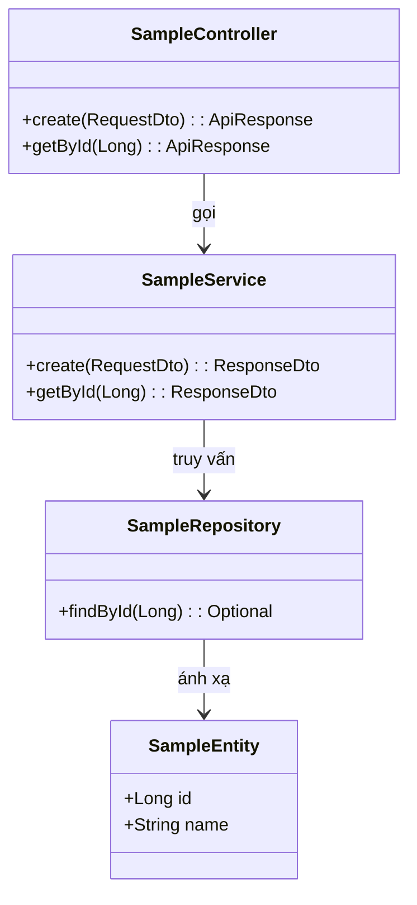

# <MÃ_CHỨC_NĂNG> — Thiết kế Thành phần & Lớp (Component & Class Design)

| Thuộc tính | Giá trị |
|---|---|
| **Mã chức năng** | `<MÃ_CHỨC_NĂNG>` — <Tên nghiệp vụ> |
| **Backend Stack** | Theo [tech-stack.md](../../../guidelines/backend/tech-stack.md) |
| **Frontend Stack** | Theo [tech-stack.md](../../../guidelines/frontend/tech-stack.md) |
| **Quy ước áp dụng** | `docs/guidelines/*/coding-convention.md` |
| **Tác giả / Ngày** | <Tên> — <YYYY-MM-DD> — v1.0 |

---

## PHẦN I — BACKEND ARCHITECTURE (Server-side)
> *(Nếu dự án là Frontend-only thì bỏ qua Phần I này)*

### 1. Cấu trúc Package & Phân tầng

```text
<package_root>.<module_name>
├── controller/        # REST Controllers (Nhận request, trả ApiResponse)
├── service/           # Business Services & Service Interfaces
├── repository/        # Spring Data JPA Repositories / Data Access
├── entity/            # JPA Entities ánh xạ Database
├── dto/               # Request & Response DTOs
└── mapper/            # MapStruct mappers (chuyển đổi Entity <-> DTO)
```

### 2. Sơ đồ tương tác lớp (Class Diagram)



### 3. Thiết kế chi tiết các Lớp

- **Controller:** Định nghĩa method, annotation `@GetMapping`, `@PostMapping`, ánh xạ path từ `ApiPaths`.
- **Service:** Xử lý logic, ranh giới `@Transactional`, kiểm tra điều kiện nghiệp vụ.
- **Entity:** Khai báo khóa chính `@Id`, `@Column`, quan hệ `@ManyToOne`, cờ boolean.
- **Repository:** Các hàm truy vấn JPA Derived queries hoặc JPQL.

---

## PHẦN II — FRONTEND ARCHITECTURE (Client-side)
> *(Nếu dự án là Backend-only thì bỏ qua Phần II này)*

### 1. Cấu trúc Module Thư mục

```text
src/modules/<feature-name>/
├── pages/             # Màn hình chính (user-list.page.tsx)
├── components/        # Component giao diện nhỏ (user-card.component.tsx)
├── hooks/             # Custom hooks chứa logic & TanStack Query (use-user.hook.ts)
├── api/               # Axios API calls (user.api.ts)
├── types/             # TypeScript interfaces & types (user.type.ts)
└── README.md          # Tóm tắt vai trò của module
```

### 2. Trách nhiệm các thành phần

- **Page Component:** Đóng gói giao diện, gọi custom hook để lấy dữ liệu, render layout.
- **Custom Hook:** Sử dụng `useQuery` / `useMutation` từ TanStack Query, xử lý state hiển thị.
- **API File:** Hàm gọi HTTP client chuẩn, parse response theo envelope `{ code, message, data }`.
