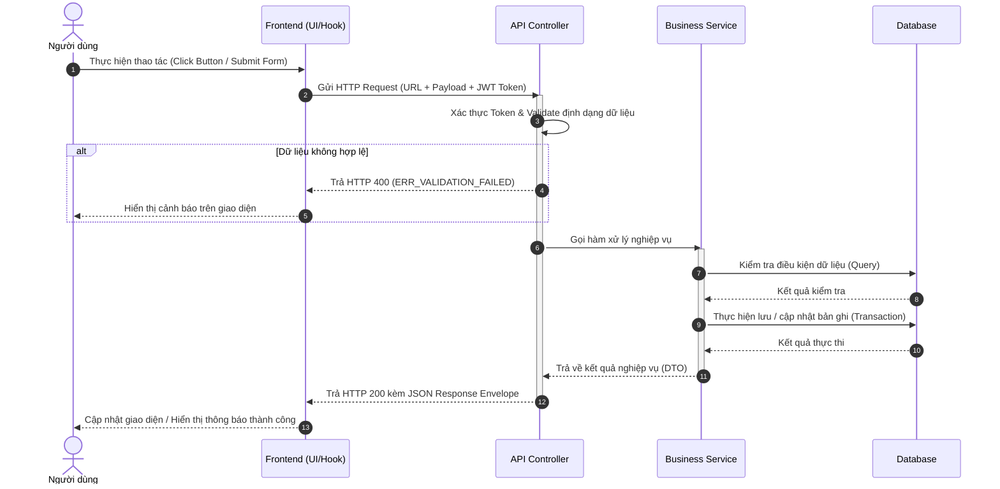

# <MÃ_CHỨC_NĂNG> — Luồng Xử lý Tuần tự (Processing Flow)

| Thuộc tính | Giá trị |
|---|---|
| **Chức năng** | `<MÃ_CHỨC_NĂNG>` — <Tên nghiệp vụ> |
| **Kiến trúc** | Client (FE) ──► Controller (API) ──► Service (Logic) ──► Repository/DB |
| **Tham chiếu** | [architecture.md](../../architecture.md), [API_Spec.md](API_Spec.md), [Component_Class_Design.md](Component_Class_Design.md) |
| **Tác giả / Ngày** | <Tên> — <YYYY-MM-DD> — v1.0 |

---

## 1. Sơ đồ tuần tự chuẩn (Sequence Diagram)

---

## 2. Các bước xử lý chi tiết theo tầng

| Bước | Phân tầng | Hành động xử lý |
|---|---|---|
| 1 | Frontend | Bắt sự kiện người dùng, validate sơ bộ trên form UI, bật trạng thái loading. |
| 2 | API / Web | Đọc JWT Bearer Token, kiểm tra quyền hạn (Role/Permission), validate DTO. |
| 3 | Service | Kiểm tra logic nghiệp vụ, chạy trong ranh giới `@Transactional`. Ném `BusinessException` nếu vi phạm điều kiện. |
| 4 | Database | Thực thi lệnh SQL / JPA persist, cập nhật dữ liệu và ghi log audit. |
| 5 | Frontend | Nhận kết quả: Revalidate cache qua TanStack Query, hiển thị toast thông báo thành công hoặc lỗi. |

---

## 3. Ràng buộc giao dịch & Xử lý ngoại lệ

- **Tính toàn vẹn (Transaction Boundary):** Thao tác ghi dữ liệu bắt buộc chạy trong transaction. Nếu có bất kỳ lỗi nào xảy ra ở các bước con, toàn bộ thay đổi phải được rollback hoàn toàn.
- **Xử lý lỗi hệ thống:** Mọi lỗi runtime không mong muốn đều được bắt tại Global Exception Handler và trả về mã `ERR_INTERNAL_SERVER`, tuyệt đối không để lộ thông tin chi tiết của cơ sở dữ liệu cho client.
