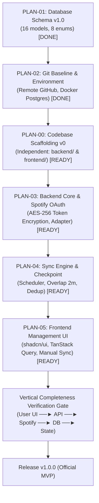

# Danh mục Kế hoạch Thực thi Đã Duyệt (Approved Implementation Plans) — MUSIC_TRACKER_MVP

> **Mã chức năng:** `MUSIC_TRACKER_MVP`  
> **Tài liệu đặc tả:** `docs/specs/business-spec/MUSIC_TRACKER_MVP/srs.md`  
> **Trạng thái phê duyệt:** ĐÃ PHÊ DUYỆT (Approved Baseline v1.0)

---

## 1. Ma trận Phân rã Công việc (Work Breakdown Structure — WBS)

| Mã Plan | Tên Kế hoạch Thực thi | Phạm vi | Cổng Kiểm soát | Trạng thái | Tài liệu Chi tiết (9 mục) |
|---|---|---|---|---|---|
| **PLAN-00** | Khởi tạo Cấu trúc Dự án (Project Scaffolding v0) | Fullstack / Architecture | Architecture Guard | **ĐÃ DUYỆT (READY)** | [plan-00-codebase-scaffolding-v0.md](plan-00-codebase-scaffolding-v0.md) |
| **PLAN-01** | Thiết kế CSDL & Schema v1.0 (16 Models, 8 Enums) | Database | Architecture Guard | **HOÀN THÀNH (DONE)** | [plan-01-database-design-v1.md](plan-01-database-design-v1.md) |
| **PLAN-02** | Khởi tạo Git & Môi trường Baseline | Hạ tầng / DevOps | Security & Scope Guard | **HOÀN THÀNH (DONE)** | [plan-02-project-scaffolding-git-baseline.md](plan-02-project-scaffolding-git-baseline.md) |
| **PLAN-03** | Backend Core & Spotify Provider Integration | Backend (NestJS) | Provider Isolation & Token Security | **ĐÃ DUYỆT (READY)** | [plan-03-backend-spotify-integration.md](plan-03-backend-spotify-integration.md) |
| **PLAN-04** | Synchronization Engine & Checkpoint Strategy | Backend (Cron) | Honest Data & Deduplication | **ĐÃ DUYỆT (READY)** | [plan-04-sync-engine-and-checkpoint.md](plan-04-sync-engine-and-checkpoint.md) |
| **PLAN-05** | Frontend Management UI & Realtime Status | Frontend (React) | UI/UX & Vertical Completeness | **ĐÃ DUYỆT (READY)** | [plan-05-frontend-management-ui.md](plan-05-frontend-management-ui.md) |

---

## 2. Tiến độ & Lộ trình Thực thi Chi tiết

---

## 3. Các Ràng buộc Bất biến Áp dụng cho Toàn bộ Plans (Global Invariants)

1. **Honest Data Rule:** Các trường `startedAt`, `endedAt`, `listenedDurationMs`, `startProgressMs`, `endProgressMs`, `completionRate` trên bảng `listening_events` **bắt buộc để `null`**. Không tự suy diễn thời lượng nghe thực tế.
2. **Spotify Policy Gate (Release Blocker):** Tuyệt đối không xây dựng hay kích hoạt các tính năng phân tích sở thích, top tracks/artists, gợi ý AI hoặc chuyển dữ liệu sang English Hub trong MVP.
3. **Provider Isolation Rule:** Mọi logic kết nối API của Spotify được đóng gói cô lập trong `src/integrations/spotify/`. Core domain chỉ làm việc với thực thể chuẩn hóa `ListeningEvent`.
4. **Token Security:** Mọi access token và refresh token lưu vào `provider_connections` đều phải được mã hóa bằng thuật toán đối xứng **AES-256-GCM**.
5. **Idempotent Sync:** Khóa unique DB `(connection_id, provider_track_id, played_at)` ngăn ngừa 100% việc sinh bản ghi trùng lặp khi chạy lại hoặc fetch có overlap.

